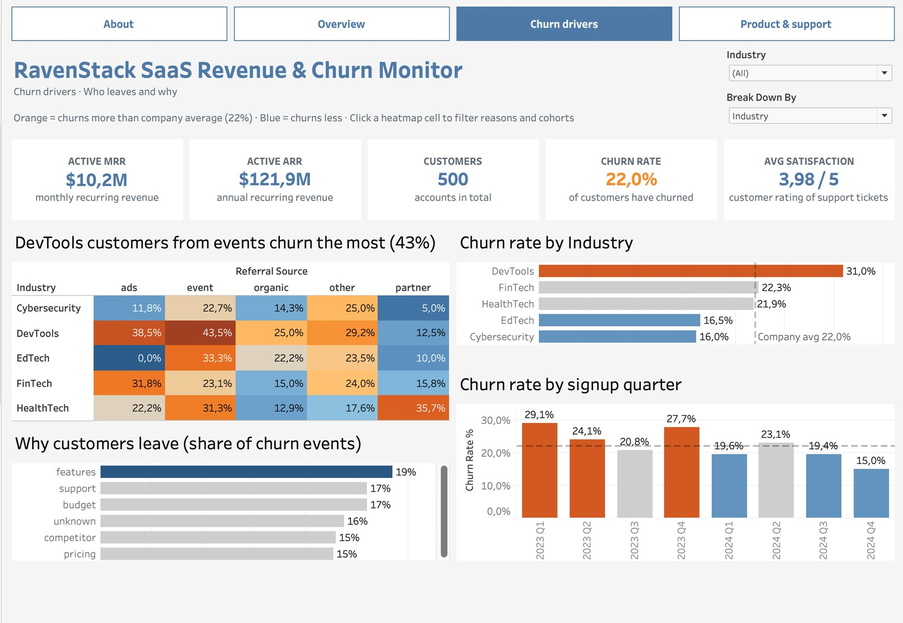
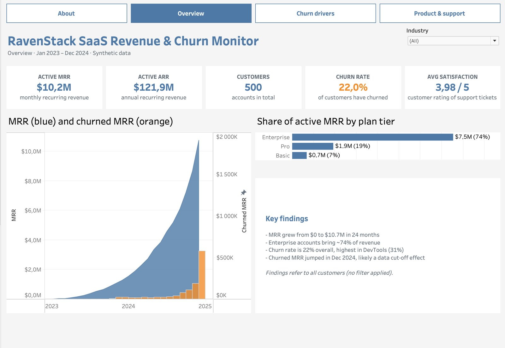
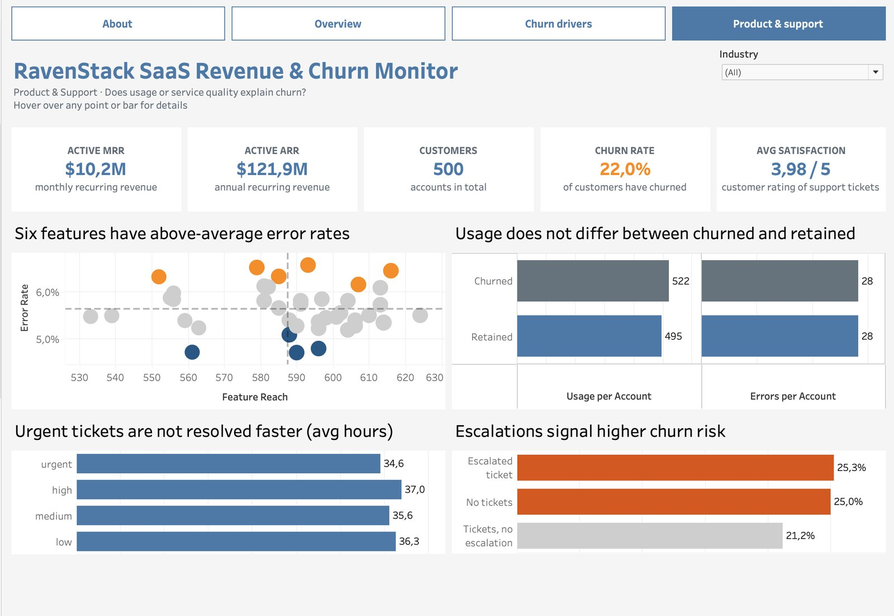
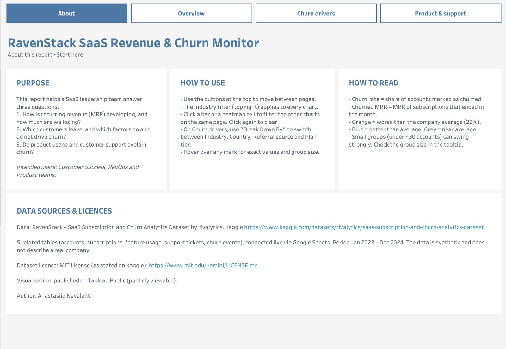

# Who leaves a SaaS company, and why?

**Tableau case study · Revenue & churn analysis**

An interactive 4-page dashboard that tracks recurring revenue, finds the customer segments that churn the most, and tests whether product usage or customer support explain it.

**[Open the live dashboard on Tableau Public →](https://public.tableau.com/app/profile/anastasiia.nevalahti/viz/RavenStackSaaSdata/About)**



---

## Summary

The company grew monthly recurring revenue (MRR) from almost zero to **$10,7M** in two years, and **22%** of its 500 customers have churned.

The analysis shows that churn depends on **who the customer is and where they came from**, not on the price plan, product usage or support speed. The riskiest segment is **DevTools companies acquired through events: 43,5% churn**, twice the company average. The safest is Cybersecurity companies coming through partners: 5%.

| Active MRR | Active ARR | Customers | Churn rate | Support CSAT |
|---|---|---|---|---|
| $10,2M | $121,9M | 500 | 22,0% | 3,98 / 5 |

---

## The business question

A fast-growing SaaS company is also losing customers. Before spending money on retention, the leadership team needs to know where to focus. The dashboard answers three questions:

1. **Revenue:** how is recurring revenue developing, and how much are we losing each month?
2. **Churn drivers:** which customers leave, and which factors do and do not drive churn?
3. **Product & support:** do product usage, product errors or support quality explain churn?

Intended users are the Customer Success, RevOps and Product teams.

---

## Data

Source: [RavenStack – SaaS Subscription and Churn Analytics Dataset](https://www.kaggle.com/datasets/rivalytics/saas-subscription-and-churn-analytics-dataset) by rivalytics, Kaggle ([MIT License](https://www.mit.edu/~amini/LICENSE.md)). The data is synthetic: it imitates a real SaaS company but does not describe one.

| Table | Rows | One row is… |
|---|---|---|
| accounts | 500 | a customer company (industry, country, acquisition channel, churn flag) |
| subscriptions | 5000 | a subscription period (dates, plan tier, MRR) |
| feature_usage | 25000 | one feature used on one day (usage count, errors) |
| support_tickets | 2000 | a support ticket (priority, resolution time, satisfaction, escalation) |
| churn_events | 600 | a cancellation (date, reason, refund) |

The five tables are stored in Google Sheets and connected to Tableau as an online data source, so the dashboard can be refreshed without any manual data preparation.

---

## Data model

The tables describe different things (companies, subscriptions, tickets), so joining them into one flat table would duplicate rows and inflate every total. Instead, they are connected with **Tableau relationships**, which keep each table at its own level of detail:

- `accounts` is the centre of the model;
- `subscriptions`, `support_tickets` and `churn_events` relate to it on `account_id`;
- `feature_usage` relates to `subscriptions` on `subscription_id`.

After building the model I checked the row counts against the source (500 / 5000 / 25000). They matched exactly, so nothing was duplicated.

### Monthly revenue: the calendar join

A subscription has only a start and an end date, so there is no row saying "this subscription was active in March 2024". To chart MRR month by month, I created a 24-month calendar in Google Sheets with a formula and joined it to a copy of the subscriptions table:

```
Start Date                        <=  Month End
IFNULL(End Date, #2099-12-31#)    >=  Month Start
```

Each subscription is repeated once for every month it was active. Using a separate copy keeps all other calculations unaffected.

---

## Data quality checks

| What I found | How I handled it |
|---|---|
| Three different definitions of churn: 110 accounts flagged as churned, 352 with a churn event, 312 with a cancelled subscription | Used the account flag (current status) for the churn rate and churn events for reasons; definitions are explained in the dashboard |
| Each customer has 2–19 subscriptions | Revenue is calculated per subscription, churn per account (distinct count) |
| The customer base grew very fast | Compared rates, never absolute counts |
| 193 of 486 ended subscriptions end in December 2024, the last month of the data | Marked on the chart as a likely data cut-off effect |
| 41% of tickets have no satisfaction score | Averages use only answered tickets |
| Some segments have fewer than 20 customers | Group size is shown in every tooltip |

---

## How it was built

**Churn rate at the right level.** A customer appears in many related rows, so churn is counted with distinct account IDs:

```
COUNTD(IF [Churn Flag] THEN [Account Id] END) / COUNTD([Account Id])
```

**Company average with a LOD expression.** The average must stay the same no matter how a chart is split:

```
{ FIXED : COUNTD(IF [Churn Flag] THEN [Account Id] END) } / { FIXED : COUNTD([Account Id]) }
```

**Colouring only meaningful differences.** 22,1% is not really "worse" than an average of 22,0%, so a segment is coloured only if it differs by more than 2 percentage points:

```
IF [Churn Rate %] - MIN([Overall Churn Rate]) > 0,02 THEN "Above average"
ELSEIF [Churn Rate %] - MIN([Overall Churn Rate]) < -0,02 THEN "Below average"
ELSE "Near average" END
```

**Interactivity:**
- navigation buttons between the four pages;
- one Industry filter that applies to every page;
- a parameter that switches a chart between industry, country, acquisition channel and plan tier;
- four filter actions: for example, clicking a cell in the heatmap shows the churn reasons, signup cohorts and KPIs of exactly that segment.

**Design rules:**
- **orange** = worse than average, **blue** = better than average or neutral, **grey** = near average, on every page;
- chart titles state the finding ("DevTools customers from events churn the most"), not just the topic;
- an About page explains purpose, how to use and read the dashboard, sources and licence.

---

## Dashboard pages

### Overview
KPIs, MRR growth with monthly churned MRR, and revenue by plan tier.



### Churn drivers
A heatmap of churn by industry and acquisition channel. Clicking a cell filters the reasons, cohorts and KPIs to that segment.


### Product & support
Tests whether product errors, usage or support quality explain churn.



### About
Purpose, instructions, metric definitions, sources and licence.



---

## Key findings

1. **Churn depends on the segment.** DevTools customers churn at 31,0%, Cybersecurity at 16,0%. Customers from events churn at 30,2%, those from partners at 14,6%.
2. **The combination matters most.** DevTools customers from events churn at 43,5% and from ads at 38,5%; Cybersecurity customers from partners at only 5,0%. For HealthTech, the partner channel is the worst (35,7%).
3. **The price plan does not drive churn.** Basic, Pro and Enterprise all churn at about 22%, so discounts or plan changes are unlikely to solve the problem.
4. **Revenue is concentrated.** Enterprise brings 74% of active MRR ($7,5M of $10,2M).
5. **Product usage does not explain churn.** Churned customers used the product as much as retained ones (522 vs 495 uses per account) and saw the same number of errors.
6. **Support priorities do not work.** Urgent tickets take 34,6 hours on average, almost the same as low-priority tickets (36,3 hours).
7. **Escalations are a warning sign.** Customers with an escalated ticket churn at 25,3%, customers whose issues were solved without escalation at 21,2%. Customers who never contacted support churn at 25,0%.

---

## Recommendations

1. **Review event marketing for DevTools.** This channel brings the customers most likely to leave; qualify these leads more strictly or move budget to partners.
2. **Treat escalations as a churn alert.** An escalated ticket should automatically notify the customer's Customer Success manager.
3. **Contact "silent" customers.** Customers who never open a ticket churn as often as escalated ones; regular check-ins could surface problems earlier.
4. **Fix the support priority process.** If urgent tickets are not solved faster, the priority label has no effect.
5. **Focus retention on Enterprise.** It is 74% of revenue, so keeping one Enterprise customer is worth the most.

---

## Limitations and next steps

- **The data is synthetic**, so the results demonstrate the method, not facts about a real company.
- **Correlation is not causation.** The dashboard shows which segments churn more, not why. A statistical churn model could measure the effect of each factor separately.
- **Older customers have had more time to leave**, so churn by signup quarter is not directly comparable; a survival analysis would be the next step.
- **Small segments** can swing strongly; confidence intervals would show the uncertainty.

---

*Data: RavenStack dataset by rivalytics, Kaggle, MIT License. Dashboard and analysis by Anastasiia Nevalahti.*
